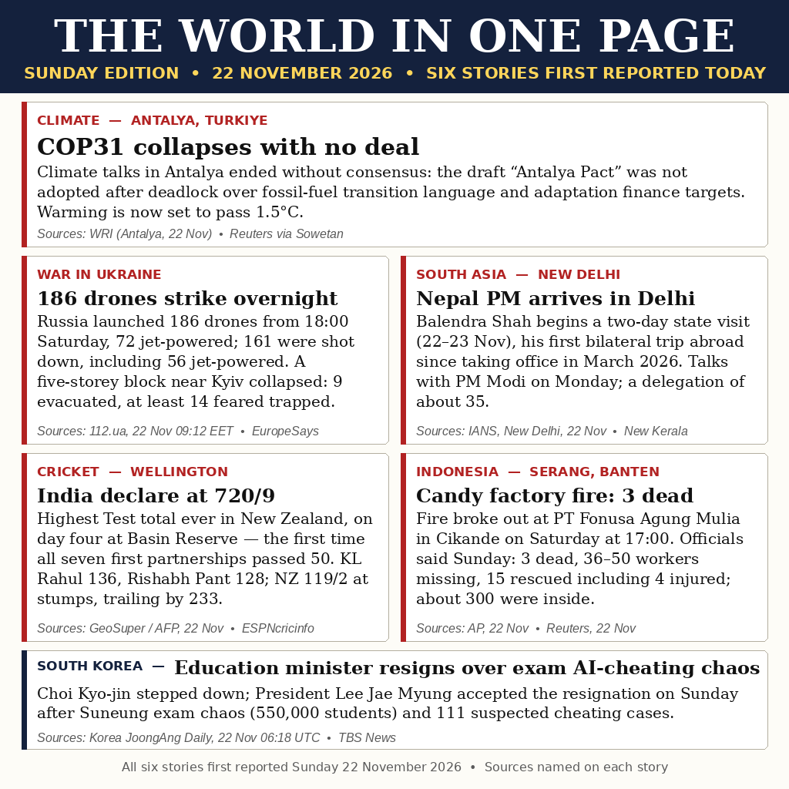

# Sunday Edition — The World in One Page: 22 November 2026

[](https://make.fun/bounty/news-image-20261122?utm_source=github&utm_medium=readme&utm_campaign=news-image-20261122)
[](https://make.fun/bounty/news-image-20261122/leaderboard?utm_source=github&utm_medium=readme&utm_campaign=news-image-20261122)
[](https://make.fun/bounty/news-image-20261122?utm_source=github&utm_medium=readme&utm_campaign=news-image-20261122)

Entry for the make.fun bounty [news-image-20261122](https://make.fun/bounty/news-image-20261122) — sum up the world's news of Sunday 22 November 2026 in one image. The program (`main.py`, Python 3.13, standard library only) copies the newspaper front page in `entry.png` to the output folder, byte for byte, so both runs are identical.



## The six stories

All six were first reported on **Sunday 22 November 2026** (two independent sources each):

1. **COP31 collapses with no deal (Antalya).** Talks ended without consensus; the draft "Antalya Pact" was not adopted after deadlock over fossil-fuel transition language and adaptation finance targets. Warming is now set to pass 1.5°C. — *WRI (Antalya, 22 Nov); Reuters via Sowetan*
2. **186 Russian drones strike overnight.** 186 drones launched from 18:00 on 21 Nov, 72 jet-powered; 161 shot down including 56 jet-powered. A five-storey apartment block near Kyiv collapsed: 9 evacuated, at least 14 feared trapped. — *112.ua, 22 Nov 09:12 EET; EuropeSays, 22 Nov*
3. **Nepal PM Balendra Shah arrives in Delhi.** Two-day state visit (22–23 Nov), his first bilateral trip abroad since taking office in March 2026; talks with PM Modi on Monday; delegation of about 35. — *IANS, New Delhi, 22 Nov; New Kerala, 22 Nov*
4. **India declare at 720/9 vs New Zealand (Wellington, day four).** Highest Test total ever in New Zealand; first time all seven first partnerships passed 50. KL Rahul 136, Rishabh Pant 128. New Zealand 119/2 at stumps, trailing by 233. — *GeoSuper/AFP, 22 Nov; ESPNcricinfo match report, day 4*
5. **Candy factory fire in Indonesia (PT Fonusa Agung Mulia, Cikande, Serang, Banten).** Fire began Saturday 17:00; officials said Sunday: 3 dead, 36–50 workers missing, 15 rescued including 4 injured; about 300 were inside. — *AP, 22 Nov; Reuters, 22 Nov*
6. **South Korea education minister Choi Kyo-jin resigns.** President Lee Jae Myung accepted the resignation on Sunday, after chaos over AI anti-cheating rules at the Suneung exam (550,000 students, Thu 20 Nov) and 111 suspected electronic-device cheating cases. — *Korea JoongAng Daily, 22 Nov 06:18 UTC; TBS News, 22 Nov*

## How it works

- `draw.py` paints the 1024×1024 newspaper page with Pillow and writes `entry.png`.
- `main.py` (the entry program) copies `entry.png` byte-for-byte to `$MAKEFUN_OUTPUT_DIR/entry.png` (fallback `/output`) and prints its size and SHA-256. No network, no clock, no randomness — deterministic across runs.

## Run it

```sh
python3 draw.py
mkdir -p out && MAKEFUN_OUTPUT_DIR=out python3 main.py
```

## License

MIT — see [LICENSE](LICENSE).
